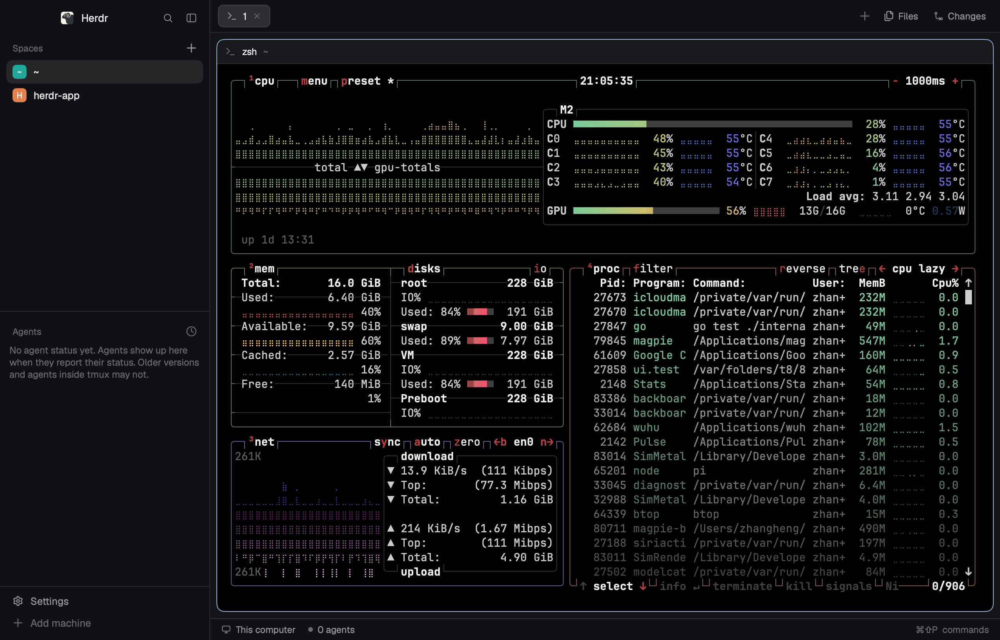

# herdr-mygo

Herdr's desktop UI, rebuilt in Go with [MyGo](https://github.com/egoist/mygo)'s
native UI. The **core is Herdr's own**: [herdr-core](https://github.com/herdrdev/herdr-core)
(`hc`) still runs every terminal, every agent and the spaces/tabs document.
This app is only the window.



```
hc (herdr-core)                  this app
┌──────────────────────┐        ┌──────────────────────────────┐
│ terminals, PTYs      │ framed │ MyGo native UI (Go, GPU)      │
│ spaces/tabs doc      │◀──────▶│ sidebar · tabs · panes        │
│ agents' status       │  RPC   │ palette · settings · panels   │
└──────────────────────┘        └──────────────────────────────┘
```

## Run

Needs Go 1.27+ and `hc` on `PATH` (the Herdr app installs it in `~/.local/bin`).

```sh
go run .
```

`herdr-core` keeps running when the window closes, exactly as with the
original app: close the window, your agents keep working.

To build an app bundle:

```sh
go tool mygo build
```

The first run downloads MyGo's `libghostty-vt` (the terminal emulator library
the terminal plugin uses, the same Ghostty VT the original app uses).

## What is here

| Files | What it does |
|---|---|
| `internal/core` | `hc connect`, the framed JSON-RPC protocol: calls, event streams, terminal attach streams, flow control |
| `internal/herdr` | the world: the `herdr-app` document (spaces → tabs → pane trees), terminal records and events, commands, git, the program table, and the attach connection that makes a core terminal a MyGo terminal |
| `internal/ui` | the window: theme, frame, sidebar, tabs, pane cards, status bar, command palette, picker, new-tab menu, context menus, settings, welcome, Files and Changes panels, toasts |
| `internal/assets` | the original app's icons, fonts (JetBrains Mono, Geist) and logo, under their licenses |

The window follows the shipped `main` layout: a 268 px sidebar with the
spaces list, the agents list and the footer; a 42 px tab bar; pane cards
(radius 10, 1 px border, accent border while focused, 30 px header); a
28 px status bar; Files/Changes as a 368 px side panel. Colors come from
Herdr's `graphite` theme, resolved with the same formula Herdr uses
(`settings.rs`), and terminals use the same palette, font and padding.

Keys are read from `~/.config/herdr-mygo/keys.json` (or `$XDG_CONFIG_HOME`,
or `$HERDR_MYGO_HOME`, else the shipped `keys.macos.json` / `keys.json`), so
`cmd-shift-p` opens the palette,
`cmd-d` splits, `cmd-1`… select tabs, and so on. Terminals get every other
key, through Ghostty's key protocol handling in MyGo's terminal plugin.

## What works

- Spaces, tabs and splits stored in the core's shared document, with labels
  (`herdr.space`, `herdr.tab`) so terminals started outside the app join them
- **SSH machines**: add one from `~/.ssh/config` or by typing how ssh reaches
  it (Add machine in the sidebar footer, or Settings → Machines); each machine
  keeps its own copy of the document (`doc.get/set … on`), its spaces are
  grouped under its header in the sidebar, and its terminals run, attach,
  split, resize and report agents through the same core, addressed
  `machine/t3`. Remote spaces are first class: new space from the machine's
  `+`, tabs and splits there, a name of `~` from that machine's own home,
  Files listing and previewing that machine's folders (`machine.exec` + `sh`),
  and Changes running git there. A machine that needs herdr-core copied, a
  password or a host key opens `hc machine add` in a terminal inside the
  dialog. Settings →
  Machines lists each machine with its state, and Connect / Remove
- Terminal attach: live output, typing, resize, colors reported to programs,
  selection, copy/paste, links, scrollback (MyGo terminal plugin)
- Focus and zoom per tab, click to focus, accent focus border
- Space/tab/pane commands: new, close, rename, move, select, next/prev,
  split right/down, close, zoom, focus/swap by direction
- The agents list from terminals that report status (OSC 7501), by priority,
  each agent with its own logo: Herdr's program table's icons (Claude Code,
  Codex, Pi, OpenCode, Grok, Gemini, …), full color where the mark is, and
  DeepSeek's for `dsh-tui`/`dsh`; a row from another machine names it
- Command palette with fuzzy search, group headers and key chips
- Go-to-space-or-tab picker, new-tab menu, right-click menus on spaces,
  tabs and panes, prompt dialogs, toasts
- Settings for Look, Terminal, Machines, Alerts, Updates and Privacy, with
  search (⌘F), a theme picker, live controls and the Paper theme; welcome and
  the keys list. Appearance follows the desktop, or stays light or dark, and
  the theme — chrome and every open terminal — changes with it: dark themes
  (Graphite, Ink, Moss) and Paper for the light
- The app keeps its own files, apart from herdr-app's, under
  `~/.config/herdr-mygo`: `settings.json` written as a setting changes, the
  keys, and the screen's view
- Files tree with file preview; Changes with git status, diff and commit
- The sidebar collapses to nothing — ⌘B, or the button in the brand bar —
  easing closed as MyGo's sidebar example does (`Animate` + `ClipX`), and
  opens again at the width it had; the width and whether it is open are
  kept in `settings.json`
- Sidebar drag to resize, spaces and machine groups dragged into order,
  window drag on the brand and tab bars, traffic lights where Herdr puts them

## What is not here yet

The original app is a general layout/mod engine: layouts are JSON, panels
are JavaScript mods. This port draws Herdr's shipped interface in Go, so:

- No `layouts/*.json` or `mods/*` execution: `terminals` and `win98` layouts,
  and user mods, do not load. Their look is fixed to `main`.
- No worktrees, terminal peek or floating blocks; panes can be split and
  focused but not dragged or resized by their divider; tabs cannot be
  drag-reordered yet.
- Machines are added over ssh only (no `--via` commands or temporary
  machines); Files reads remote folders one level at a time through
  `machine.exec`, so it has no git-ignore dimming and refreshes every few
  seconds rather than on every change.
- No session settling, update checks, telemetry, or `herdr-app do` control
  socket. Previews (Files, Changes) are read-only except the commit box.
- Zoom is not written back to `settings.json` yet, and the Alerts, Updates
  and Privacy controls are presentational: the app has no sound, update
  check or telemetry yet.

## How it is checked

`internal/ui/shot_test.go` renders the window without a window and saves a
2× PNG, which is compared against the original's own `herdr-app shot` at the
same size and scale. The screenshots in `docs/` were made that way.

```sh
SHOT_OUT=/tmp/main.png go test ./internal/ui -run TestShot
SHOT_OVERLAY=palette SHOT_OUT=/tmp/palette.png go test ./internal/ui -run TestShot
SHOT_PANEL=files SHOT_OUT=/tmp/files.png go test ./internal/ui -run TestShot
SHOT_ACTION=pane.split:down SHOT_OUT=/tmp/split.png go test ./internal/ui -run TestShot
```

## Research

[docs/herdr-ui-spec.md](docs/herdr-ui-spec.md) is the study of the original
app this port is built from: the model, the layout metrics, the theme, every
panel and overlay, keys and commands, and where each piece lives in Go.
